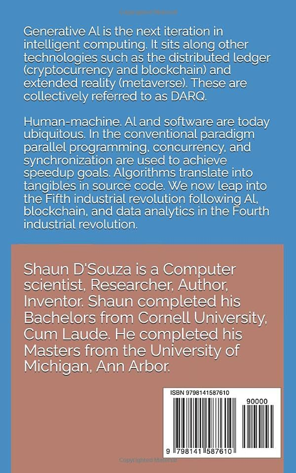
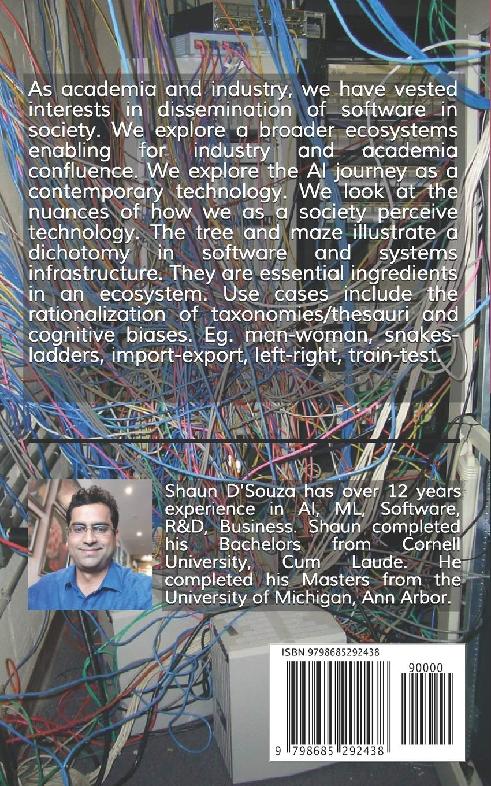

## [Unwrapping Abstraction: Industrial Salt](https://www.amazon.com/dp/B0HRPR57ZK)

Generative Al is the next iteration in intelligent computing. It sits along other technologies such as the distributed ledger (cryptocurrency and blockchain) and extended reality (metaverse). These are collectively referred to as DARQ.

Human-machine. Al and software are today ubiquitous. In the conventional paradigm parallel programming, concurrency, and synchronization are used to achieve speedup goals. Algorithms translate into tangibles in source code. We now leap into the Fifth industrial revolution following Al, blockchain, and data analytics in the Fourth industrial revolution.

 
## [A Retrospective on Enabling a Connected World: The Race for the Original Primordial Soup](https://www.amazon.com/dp/B08KJCRKTN)
### [Audiobook](https://play.google.com/store/audiobooks/details?id=AQAAAEDq8GWwnM)

As academia and industry, we have vested interests in dissemination of software in society. We explore a broader ecosystems enabling for industry and academia confluence. We explore the AI journey as a contemporary technology. We look at the nuances of how we as a society perceive technology. The tree and maze illustrate a dichotomy in software and systems infrastructure. They are essential ingredients in an ecosystem. Use cases include the rationalization of taxonomies/thesauri and cognitive biases. Eg. man-woman, snakes-ladders, import-export, left-right, train-test.

